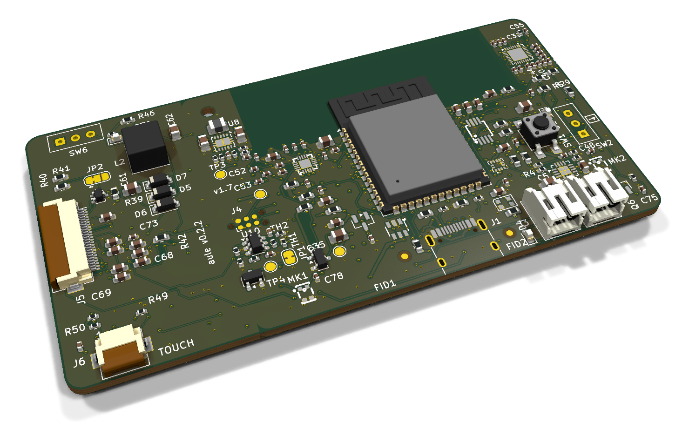

# Hardware

Everything physical in Aule: the board, its fabrication package, its 3D model and the desk dock that holds the e-ink panel.

> **Prototype v0.2.2.** The design passes its electrical and design-rule checks, but the first boards have not been brought up yet. Treat it as a reference, not a kit, until they are.

## Folder layout

```text
pcb/          KiCad 10 project of the board (schematic in four sheets, layout, project libraries)
fab/          JLCPCB package: Gerbers, drill files, BOM.csv and CPL.csv
board/        STEP model of the assembled board, with every part, and a render
enclosure/    Desk dock: build123d source, STEP and STL of each part, renders and print settings
ordering/     How to check JLCPCB's placement preview, part by part, before paying
```

## Board (`pcb/`)



- 92 × 48 mm, 4 layers, 147 parts, all orderable from LCSC.
- Open `pcb/esp32-audio-module.kicad_pro` with **KiCad 10**. Project-specific symbols and footprints are in `pcb/heypcb-libs/`; everything else comes from KiCad's standard libraries.
- Sheets:
  - `mcu`: ESP32-S3 module, LIS2DH12 accelerometer, talk button, touch connector (J6), programming pads.
  - `audio`: ES7210 microphone ADC, ES8311 codec, PAM8302A amplifier, two MEMS microphones, speaker connector, microphone mute switch.
  - `power`: BQ24075 charger with power path, TPS63000 buck-boost, battery thermal cut-off, USB protection, power switch, battery connector.
  - `connectors`: USB-C, e-ink panel connector (J5) and its high-voltage booster.
- **Microphone mute is pure hardware.** The slide switch cuts the microphones' bias supply and the green "mic on" LED with it; the firmware cannot turn either back on.
- Checks for this revision: DRC with the project rules, **0 errors** ([`pcb/drc.json`](pcb/drc.json)); ERC, **0 errors** ([`pcb/erc.json`](pcb/erc.json)). DRC warnings are silkscreen overlaps and footprint library-version mismatches; ERC warnings are pin-type notices.
- What changed in v0.2.2: only L2, the inductor of the e-ink high-voltage booster, from 68 µH to 10 µH (Sunlord SWPA6045S100MT, C79272), as the UC8179 panel controller requires.

**Not measured yet:** the high-voltage booster with the new inductor, the real panel and touch flex positions, and touch sensing through the optional lens.

## Fabrication (`fab/`)

The files of our first order (12 November 2026), with one change since: the silkscreen text now says «aule». The files exactly as ordered are at commit [`68c8f9a`](https://github.com/meet-aule/aule-hw/tree/68c8f9a/hardware/fab). Upload the Gerber files as a ZIP, then `BOM.csv` and `CPL.csv` for assembly. `CPL-rotations.txt` explains where each rotation comes from. Read [`ordering/`](ordering/README.md) before confirming the order: the placement preview is the one check that cannot be done from the files.

## Enclosure (`enclosure/`)

A folding desk dock (194 × 138.5 mm) in seven printed parts, about 13.5 hours and 387 g of PETG. The source is parametric ([build123d](https://github.com/gumyr/build123d)) and checks itself: `dock.py` runs 635 fit checks against the board model in `board/`, and `printcheck.py` checks every printed layer for overhangs. Details, print settings, hardware list and assembly in [`enclosure/README.md`](enclosure/README.md).

## Firmware pin map

The pins the firmware needs are in [`../software/`](../software/).
